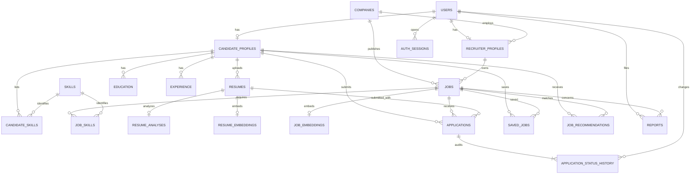

# HireAI entity relationships

Each entity has an integer surrogate primary key. Profiles are unique per user;
association tables have composite keys. Applications and saved jobs are unique per
candidate/job. Skills are unique by canonical lowercase name. Resume/application
references are retained when a resume is retired; physical removal is refused while
it is evidence for an application. Job deletion is refused after applications;
close the job instead. Cascades remove dependent joins, embeddings and caches.
